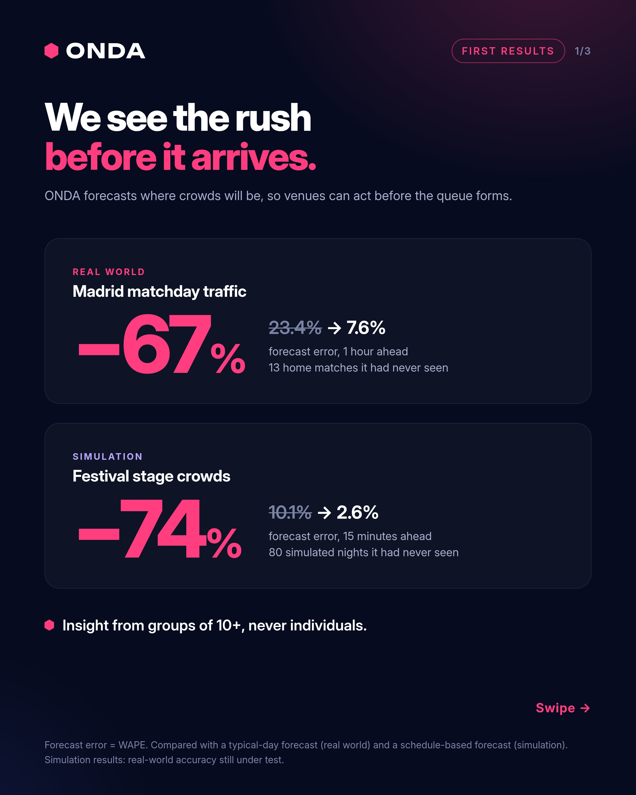
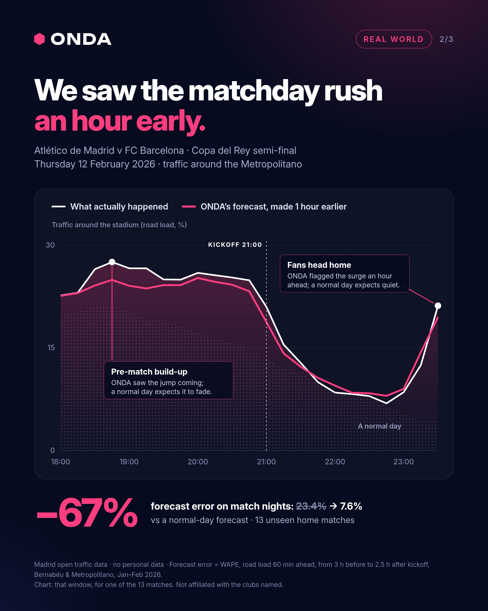
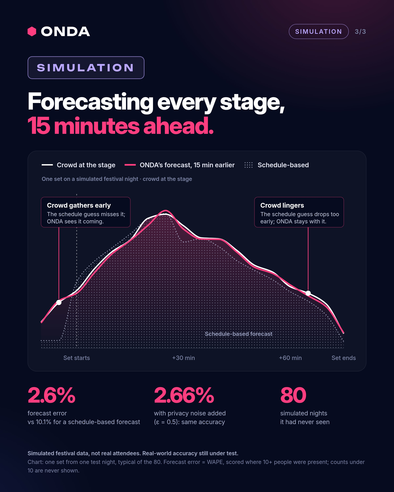

# ONDA: first results

ONDA turns ticket scans, wristband taps and payments into live, privacy-safe crowd insight and forecasts for festivals, clubs and stadiums.

Website: https://onda-website.onrender.com

## Where ONDA stands today

First results: one on real public data, one in simulation. Plus an honest account of how far along we are.

### Real world: Madrid matchday traffic

**−67% forecast error.** 23.4% → **7.6%**, one hour ahead.

Compared with a typical-day forecast, on 13 home matches it had never seen. Built only on Madrid’s open traffic data around the Bernabéu and the Metropolitano. No personal data.

### Simulation: festival stage crowds

**−74% forecast error.** 10.1% → **2.6%**, 15 minutes ahead.

Compared with a schedule-based forecast, across 80 simulated nights it had never seen. With privacy noise added (ε = 0.5) it stays at 2.66%. Simulated festival data, not real attendees: real-world accuracy still under test.

### Insight from groups of 10+, never individuals

Every number ONDA shows describes a group of at least ten people. Anything smaller is held back, never shown.

### Where we are

It’s early. The engine works and the privacy gate is in place, but ONDA has no customers yet. Real attendee data comes in only after a full data protection impact assessment. We’re looking for our first pilots with clubs and festivals.

## Slides

---

Forecast error = WAPE. Simulation results: real-world accuracy still under test. Not affiliated with the clubs named.

Contact: [iancerruti@gmail.com](mailto:iancerruti@gmail.com?subject=ONDA%20pilot%20event)

© 2026 ONDA. All rights reserved.
